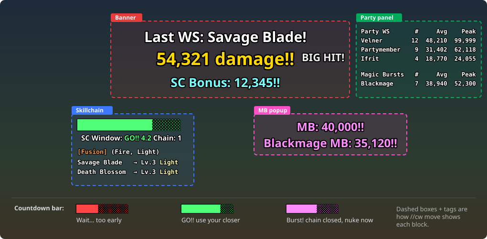

# CrankWatch 3.0

A weapon skill and Magic Burst tracker for Windower 4, with a built-in
skillchain helper based on Ivaar's **SkillChains**.



The screen has four **blocks**. Each one moves and resizes on its own:

| Block | What it shows | On by default? |
|---|---|---|
| **Banner** | Your last WS and its damage, hit flair, SC Bonus | yes |
| **Skillchain** | Wait/GO countdown bar and what you can close with | yes |
| **MB popup** | Magic Bursts on your target, yours and your party's | yes |
| **Party panel** | Everyone's WS and Magic Burst totals | no (`//cw party on`) |

> **Is it safe?** CrankWatch only *reads* packets the server already sent to
> your client, and draws text. It never sends, injects or changes packets,
> and it doesn't automate anything.

---

## Contents

1. [Install](#1-install)
2. [Two-minute setup](#2-two-minute-setup)
3. [The four blocks](#3-the-four-blocks)
4. [Moving and resizing](#4-moving-and-resizing)
5. [How do I…?](#5-how-do-i)
6. [All commands](#6-all-commands)
7. [settings.xml](#7-settingsxml)
8. [What gets counted](#8-what-gets-counted)
9. [Troubleshooting](#9-troubleshooting)
10. [Offline tests (developers)](#10-offline-tests-developers)

---

## 1. Install

1. Copy these files into `Windower/addons/CrankWatch/`:

   | File | What it does |
   |---|---|
   | `CrankWatch.lua` | Main file: settings, events, `//cw` commands |
   | `skills.lua` | Skillchain properties for every WS, spell and pet move |
   | `sc_engine.lua` | Skillchain tracking (port of Ivaar's SkillChains) |
   | `party_tracker.lua` | Who's in your party, plus WS and MB stats |
   | `ui_hud.lua` | Everything drawn on screen |

   The `docs/` folder only holds the picture above. The game doesn't need it.

2. **Unload SkillChains.** CrankWatch includes it, and running both gives you
   two skillchain displays:
   ```
   //lua u skillchains
   ```
   Also delete `lua load skillchains` from `Windower/scripts/init.txt`.

3. **Load CrankWatch:**
   ```
   //lua l crankwatch
   ```
   To load it every time, add `lua load crankwatch` to `Windower/scripts/init.txt`.

**Updating:** copy the new files over the old ones, then `//lua r crankwatch`.
Your settings are kept.

**Settings file:** `Windower/addons/CrankWatch/data/settings.xml`, created on
first load. Coming from CrankWatch 2.0? Your positions, fonts and sizes carry
over. Run these once:

```
//cw scburst 0     turn off the old 0.45s chain reset
//cw reset         clear stats left from older builds
//cw resetpos      put the blocks in their new default places
```

> **Saved settings beat new defaults.** When an update changes a default
> (for example Step, Avg or alliance now start off), your saved file keeps
> the old value. Use the matching command once:
> `//cw sc step all off`, `//cw avg off`, `//cw alliance off`.

---

## 2. Two-minute setup

Recommended for seeing your WSs, your party's WSs, and party Magic Bursts:

```
//cw bannermode party    show every party member's WS on the banner, with their name
//cw party on            turn on the party panel (WS and MB totals)
//cw move                drag the blocks where you want them
//cw move                ...and again to finish (positions save automatically)
```

That's it. Already on by default:

- party mages' bursts pop up with their name (`//cw mbparty`)
- pets are counted (`//cw pets`)
- the skillchain block, with the countdown bar

Off by default, turn on if you want them:

| You want… | Type |
|---|---|
| Trusts counted | `//cw trusts on` |
| The other parties in an alliance counted (can get spammy) | `//cw alliance on` |
| Your average on the banner (the party panel already shows it) | `//cw avg on` |
| The banner to clear when the mob dies, not after 60 s | `//cw killfade on` |

**Party too busy?** `//cw bannermode self` keeps the banner to your own
WSs. The party panel still tallies everyone.

**First fight:** type `//cw debug`, fight once, then `//cw debug` again. If
chat showed `Unknown message id …` or `Action error …`, note it so it can
be fixed.

---

## 3. The four blocks

### Banner

```
Last WS: Savage Blade!          ← the WS ("Name: WS!" in party banner mode)
   54,321 damage!! BIG HIT!     ← damage, with flair for big hits
Avg: 43,210 ↑                   ← optional: //cw avg on
   SC Bonus: 12,345!!           ← when a skillchain closes on your target
```

**Damage colours**

| Damage | Colour | Flair |
|---|---|---|
| under 10,000 | white | |
| 10,000+ | blue | |
| 50,000+ | gold | BIG HIT! (and a quick grow-and-settle "pop") |
| 80,000+ | red | MASSIVE HIT!! |
| 99,999 | purple | CRANKED!!! (CRANKED x N for a streak) |
| miss | | WHIFF!! with a shake |

- **Hit flair** starts at the right end of the damage line, then floats up and fades.
- **SC Bonus** appears under the banner when a WS closes a skillchain on
  your target.
- **Avg line** (off by default): the average for whoever's WS is shown, plus
  a trend arrow after 10 WSs: ↑ last 5 WSs more than 2% above the 20 before,
  ↓ more than 2% below, → otherwise.
- **How long it stays:** fades in on each WS, holds 60 seconds, fades out
  over 5. Change with `//cw fadetime <hold> <fade>` or `//cw killfade on`.

### Skillchain block

```
██████████████░░░░                    ← countdown bar
   SC Window: GO!! 4.2  Chain: 1      ← state, seconds left, skillchains so far
[Fusion] (Fire, Light)                ← skillchain on the mob, and burst elements
Savage Blade     → Lv.3 Light         ← closer list: what YOU can use next
Death Blossom    → Lv.3 Light            (highest level first)
```

| Bar colour | Means |
|---|---|
| 🟥 red, `Wait. . .` | Too early to continue the chain |
| 🟩 green, `GO!!` | Use your closer now |
| 🟪 pink, `Burst!` | The chain is closed: nuke for a Magic Burst |

- Appears as soon as **anyone** (in your party or not) starts a skillchain
  on your current target.
- Each mob keeps its own chain, so changing targets doesn't reset it.
- The closer list only shows what you can use: your weapon skills, plus
  Immanence on SCH, blue magic on BLU, and pet moves on BST/SMN. It knows
  about Aeonic weapons and Aftermath.
- Up to 4 closer rows (`//cw sc rows <N>`, 0 = all).
- **Chain: N** is how many skillchains are made so far. There's also an
  optional **Step** line (`Step: 2 → Savage Blade`) that counts WSs instead;
  it's always Chain + 1, so it's off by default (`//cw sc step all on`).
- **Just want the bar?** `//cw scdetail off` hides the properties line and
  closer list.
- Lines you turn off leave no gap: the rest move up.

### MB popup

```
MB: 40,000!!                ← yours
Blackmage MB: 35,120!!      ← a party member's, named
```

Shows bursts on your **current target**. Bursts that land together stack, up
to 4 lines. `//cw mbparty off` shows only yours.

### Party panel

```
Party WS        #      Avg     Peak
Velner         12   48,210   99,999
Partymember     9   31,402   62,118

Magic Bursts    #      Avg     Peak
Blackmage       7   38,940   52,300
```

- Sorted by total damage, up to 8 rows per section.
- Stays on screen while it has anything recorded; hides itself when empty.
- Magic Bursts are counted on **any** mob, not only your target.
- Clear it with `//cw reset` (or `reset ws` / `reset mb`).
- WS totals only? `//cw party mb off` hides the Magic Bursts section.

---

## 4. Moving and resizing

### Move: `//cw move`

Every block you have turned on shows up with sample data, a **coloured
dashed box** and a **name tag**, just like the picture at the top. The block
under your mouse lights up.

1. **Drag** a block with the left mouse button. Grab it by its **name tag**
   if blocks overlap.
2. It saves the moment you let go.
3. Type `//cw move` again to finish.

- Blocks you've turned off (party panel off, for example) don't appear.
- Clicks on empty screen still go to the game.
- To shift the **whole HUD** at once: `//cw pos <x> <y>`.
- If the skillchain block or party panel would go off screen, it flips to
  the other side of the banner automatically.

**Messed it up?** `//cw resetpos` puts every block back in its default place.
Sizes and other settings are kept.

### Resize: one number per block

Everything inside a block (text and spacing) scales together:

| Command | Block | Default |
|---|---|---|
| `//cw size <n>` | Banner | 36 |
| `//cw skillchainsize <n>` | Skillchain | 13 |
| `//cw partysize <n>` | Party panel | 13 |
| `//cw mbsize <n>` | MB popup | 24 |

`//cw size` with no number lists all four. After resizing, `//cw move` if
something needs nudging.

Also: `//cw font <name>` (banner font), `//cw stroke <n>` (outline; try 2–3
for a small banner).

---

## 5. How do I…?

| I want to… | Type |
|---|---|
| See everyone's WSs on the banner | `//cw bannermode party` |
| See only my own WSs on the banner | `//cw bannermode self` |
| See party totals | `//cw party on` |
| Hide Magic Bursts on the party panel | `//cw party mb off` |
| Print stats to chat | `//cw stats` |
| Clear stats | `//cw reset` (`reset ws` / `reset mb` for one board) |
| Make the banner go away sooner | `//cw fadetime 10 3` or `//cw killfade on` |
| Keep the banner up permanently | `//cw fade off` |
| Hide everything right now | `//cw hide` (back with `//cw show` or your next WS) |
| Move things | `//cw move` |
| Put everything back where it was | `//cw resetpos` |
| Make the banner smaller | `//cw size 28` |
| Show only the skillchain bar, no closer list | `//cw scdetail off` |
| Turn off the skillchain block entirely | `//cw scbar off` |
| Show the skillchain block only while the banner is up | `//cw schud off` |
| See more closer rows | `//cw sc rows 8` |
| Stop a WS (e.g. Myrkr) counting in stats | `//cw blacklist add Myrkr` |
| Count AoE WS damage on every target hit | `//cw aoesum on` |
| See what the HUD looks like | `//cw test`, `testbar`, `testmb`, `testparty` |
| Start completely fresh | `//cw factoryreset` |

---

## 6. All commands

Type `//cw` or `//crankwatch`. A number command with no value prints the
current value. Changes save immediately.

### Everyday

| Command | What it does |
|---|---|
| `//cw move` | Move mode on/off |
| `//cw stats` | Print every tracked player's WS and MB stats to chat |
| `//cw reset` | Clear WS stats, averages and MB tallies (`//cw resetavg` also works) |
| `//cw reset ws` / `reset mb` | Clear only WS stats / only MB tallies |
| `//cw show` | Show the banner now |
| `//cw hide` | Hide everything until `//cw show` or your next WS |
| `//cw resetpos` | Put every block back in its default place (keeps sizes and settings) |
| `//cw help` | List all commands |

### Who is tracked

| Command | Default | What it does |
|---|---|---|
| `//cw bannermode self\|party` | self | `self`: only your WSs on the banner. `party`: everyone's, labelled `Name: WS!` |
| `//cw pets on\|off` | on | Count pets' damaging TP moves and blood pacts |
| `//cw trusts on\|off` | off | Count trusts' weapon skills |
| `//cw alliance on\|off` | off | Also count the other parties in your alliance |
| `//cw aoesum on\|off` | off | AoE WSs: off counts the main target only; on adds up every target |
| `//cw blacklist add <ws>` | | Keep a WS out of stats and the banner (still counts for skillchains) |
| `//cw blacklist remove <ws>` | | Take a WS off the blacklist |
| `//cw blacklist list` | Myrkr, Dagan, Starlight, Moonlight | Show the blacklist |
| `//cw autoreset on\|off` | on | Clear stats when you zone |
| `//cw avg on\|off` | off | `Avg:` line and trend arrow on the banner |

### Banner

| Command | Default | What it does |
|---|---|---|
| `//cw size <n>` | 36 | **Banner size** (`//cw bannersize` also works). No number: list all block sizes |
| `//cw pos <x> <y>` | 1475 850 | Moves the **whole HUD**; every block keeps its place relative to it |
| `//cw font <name>` | Highwind | Banner font |
| `//cw stroke <px>` | 4 | Outline width (big hits use this +1) |
| `//cw fade on\|off` | on | Off: the banner stays up permanently |
| `//cw fadetime <hold> <out>` | 60 5 | Seconds to hold, then seconds to fade out |
| `//cw fadein <sec>` | 0.3 | Damage line fade-in time |
| `//cw killfade on\|off` | off | Fade the banner as soon as the mob it hit dies |
| `//cw killfade <sec>` | 1 | How long that fade takes |
| `//cw gap <px>` | 45 | Damage line distance below the WS line |
| `//cw avggap <px>` | 99 | `Avg:` line distance below the WS line |
| `//cw flairgap <px>` | 58 | Flair distance below the WS line |
| `//cw pop on\|off` | on | Grow-and-settle effect on 50,000+ hits |
| `//cw popsize <n>` / `poptime <sec>` | 8 / 0.35 | Pop strength / duration |
| `//cw flairfade <sec>` | 1.5 | Flair float-away time |
| `//cw flairshrink <n>` | 6 | How much the flair shrinks as it fades |
| `//cw flairfloat <px>` | 32 | How far the flair floats up |
| `//cw whiffshake <strength> <sec>` | 6 0.45 | WHIFF shake |
| `//cw scsize <n>` | 34 | SC Bonus text size |
| `//cw scfade <sec>` | 4 | SC Bonus float-away time |
| `//cw scfloat <px>` | 28 | How far SC Bonus floats up |
| `//cw scoffset <px>` | 4 | Gap between SC Bonus and the line above it |
| `//cw layout` | | Print position, gaps and font |

### Skillchain block

| Command | Default | What it does |
|---|---|---|
| `//cw skillchainsize <n>` | 13 | **Skillchain block size** |
| `//cw scbar on\|off` | on | The whole block |
| `//cw schud on\|off` | on | On: shows whenever your target has a chain. Off: only while the banner is up |
| `//cw scdetail on\|off` | on | Properties line and closer list (every job). Off: just the bar and timer |
| `//cw sc rows <N>` | 4 | Max closer rows, highest level first. 0 = all |
| `//cw sc color` | on | Coloured skillchain names |
| `//cw sc <part>` | see below | Turn one part on/off **for your current job** |
| `//cw sc <part> all on\|off` | | Turn one part on/off **for every job**, e.g. `//cw sc step all off` |
| `//cw scaeonic on\|off` | off | Assume other players have their Aeonic weapon (affects Lv.4 predictions) |
| `//cw scburst <sec>` | 0 | Reset the chain if two *different* actions hit within this many seconds. 0 = off |
| `//cw scbardelay <sec>` | 3 | Wait time when a WS has no known delay |
| `//cw scbarwidth <chars>` | 18 | Bar length in characters (min 6) |
| `//cw scbargap <px>` | 132 | Block's top edge below the banner centre (or drag it) |

Fine-tuning single lines (the block size above is usually all you need):

| Command | Default | What it does |
|---|---|---|
| `//cw scbarsize <n>` | 18 | Bar size |
| `//cw scbarlabelsize <n>` | 15 | `SC Window:` text size |
| `//cw scbarlabeloverlap <px>` | 20 | How far `SC Window:` sits below the bar |
| `//cw scchaincountersize <n>` | 18 | `Chain: N` size |
| `//cw scchaincountergap <px>` | 6 | Gap between `GO!!` and `Chain: N` |
| `//cw scdetailsize <n>` | 13 | Closer list text size |

**Per-job parts** for `//cw sc <part>` (same as SkillChains). Each remembers
its own on/off for every job:

| Part | On for | Controls |
|---|---|---|
| `timer` | all jobs | Seconds after `Wait`/`GO!!`/`Burst!` |
| `step` | no jobs | The `Step: N → WS` line |
| `props` | all jobs | The `[skillchain] (elements)` line |
| `burst` | all jobs | Burst phase after a chain closes, and burst elements |
| `weapon` | all jobs | Your weapon skills in the closer list |
| `spell` | SCH, BLU | Immanence (SCH) or blue magic (BLU) in the closer list |
| `pet` | BST, SMN | Pet moves in the closer list (while your pet is out) |

### MB popup

| Command | Default | What it does |
|---|---|---|
| `//cw mbsize <n>` | 24 | **MB popup size** |
| `//cw mb on\|off` | on | MB popups at all |
| `//cw mbparty on\|off` | on | Also party members' bursts (named). Off: only yours |
| `//cw mbx <px>` / `mby <px>` | 95 / 101 | Position from the banner centre (or drag it) |

MB totals on the party panel are always collected, whatever `mb` and
`mbparty` are set to.

### Party panel

| Command | Default | What it does |
|---|---|---|
| `//cw party on\|off` | off | Show the party panel |
| `//cw partysize <n>` | 13 | **Party panel size** |
| `//cw party fade on\|off` | off | On: fades out with the banner. Off: stays while it has data |
| `//cw party mb on\|off` | on | Off: hide the Magic Bursts section, show WS totals only (bursts are still tallied) |
| `//cw partypos <dx> <dy>` | 260 0 | Position from the banner centre (or drag it) |

### Test displays (never touch your stats)

| Command | Shows |
|---|---|
| `//cw test` | Savage Blade, 29,973 |
| `//cw testwhite` | Savage Blade, 9,999 (white) |
| `//cw testbig` | Stardiver, 65,000 (BIG HIT) |
| `//cw testred` | Savage Blade, 90,000 (MASSIVE HIT) |
| `//cw testmassive` | Torcleaver, 99,999 (CRANKED) |
| `//cw testcrankedstreak` | three 99,999s (CRANKED x N) |
| `//cw testwhiff` | a miss |
| `//cw testbar` | a sample WS plus a 10-second Wait → GO bar |
| `//cw testmb [damage]` | a sample MB popup |
| `//cw testparty` | a sample party panel for 10 seconds |

### Maintenance

| Command | What it does |
|---|---|
| `//cw factoryreset` | Put **every** setting back to default, including per-job parts and the blacklist |
| `//cw debug` | Extra chat detail: unknown message IDs, skillchains seen, ignored actions |

`//cw testsc`, `//cw scinfogap` and `//cw scdetailgap` belonged to the old
chain line, which was removed; they just say so.

---

## 7. settings.xml

`Windower/addons/CrankWatch/data/settings.xml`. Almost everything has a
command (section 6), so you rarely need to edit it. Keys marked **file only**
have no command: edit the file, then `//lua r crankwatch`.

Sizes are font points; positions and gaps are pixels.

<details>
<summary><b>Banner and SC Bonus keys</b></summary>

| Key | Default | Meaning |
|---|---|---|
| `center_x`, `center_y` | 1475, 850 | HUD centre (`//cw pos`). Every block is placed from here |
| `banner_offset_x`, `banner_offset_y` | 0, 0 | Banner position from the HUD centre (set by `//cw move`) |
| `ws_size` | 36 | `Last WS` line size |
| `dmg_size` | 42 | Damage line size |
| `avg_size` | 24 | `Avg:` line size |
| `flair_size` | 32 | Flair size |
| `line_gap` | 45 | Damage line below the WS line |
| `avg_gap` | 99 | `Avg:` line below the WS line |
| `flair_gap` | 58 | Flair height below the WS line (level with the damage line) |
| `font` | Highwind | Banner font |
| `stroke_width` | 4 | Outline width |
| `big_stroke_width` | 5 | Outline width for 50,000+ hits |
| `fade_enabled` | true | Fade the banner in and out |
| `fade_in_duration` | 0.3 | Damage fade-in seconds |
| `hold_duration` | 60 | Seconds the banner stays after a WS |
| `fade_out_duration` | 5 | Fade-out seconds |
| `banner_hide_on_kill` | false | Fade when the WS's target dies (`//cw killfade`) |
| `kill_fade_duration` | 1.0 | Seconds for that fade |
| `show_banner_avg` | false | Show the `Avg:` line (`//cw avg`) |
| `pop_enabled`, `pop_duration`, `pop_bonus_size` | true, 0.35, 8 | Big-hit pop |
| `flair_fade_duration` | 1.5 | Flair float-away seconds |
| `flair_shrink_size` | 6 | Flair shrink while fading |
| `flair_float_distance` | 32 | Flair float distance |
| `flair_anchor_ratio` | 1.0 | **File only.** Where the flair starts along the damage line (0 = left edge, 1 = right end; 2.0 used 0.72) |
| `flair_offset_y` | −6 | **File only.** Flair vertical nudge |
| `whiff_shake_duration`, `whiff_shake_strength` | 0.45, 6 | WHIFF shake |
| `sc_enabled` | true | **File only.** Show the SC Bonus float |
| `sc_size` | 34 | SC Bonus size |
| `sc_offset_y` | 4 | Gap above SC Bonus (`//cw scoffset`) |
| `sc_fade_duration` | 4 | SC Bonus float-away seconds |
| `sc_float_distance` | 28 | SC Bonus float distance |

</details>

<details>
<summary><b>Skillchain block keys</b></summary>

| Key | Default | Meaning |
|---|---|---|
| `sc_bar_enabled` | true | Whole skillchain block |
| `sc_hud_independent` | true | Show without the banner (`//cw schud`) |
| `sc_bar_gap`, `sc_bar_offset_x` | 132, −200 | Block's top-left corner from the HUD centre (set by `//cw move`) |
| `sc_bar_size` | 18 | Bar size |
| `sc_bar_width` | 18 | Bar length in characters |
| `sc_bar_font` | Consolas | **File only.** Bar font (keep it monospaced) |
| `sc_bar_label_size` | 15 | `SC Window:` size |
| `sc_bar_label_overlap` | 20 | `SC Window:` distance below the bar |
| `sc_bar_delay` | 3.0 | Wait time when a WS has no known delay |
| `sc_bar_shake_duration`, `sc_bar_shake_strength` | 0.35, 5 | **File only.** Shake when the bar turns GO |
| `sc_bar_burst_window` | 0 | Chain reset window for two different actions (0 = off) |
| `sc_chain_counter_enabled` | true | **File only.** Show `Chain: N` |
| `sc_chain_counter_size`, `sc_chain_counter_gap` | 18, 6 | `Chain: N` size and gap |
| `sc_detail_enabled` | true | Properties line and closer list (`//cw scdetail`) |
| `sc_detail_size` | 13 | Closer list size |
| `sc_detail_font` | Consolas | **File only.** Closer list font (keep it monospaced) |
| `sc_closer_rows` | 4 | Max closer rows (`//cw sc rows`, 0 = all) |
| `sc_color` | true | Coloured skillchain names |
| `sc_aeonic` | false | Assume others have Aeonic weapons |
| `Show` | see section 6 | Per-job parts: `burst`, `pet`, `props`, `spell`, `step`, `timer`, `weapon` each list the jobs they're on for, e.g. `<pet>BST,SMN</pet>` |

</details>

<details>
<summary><b>MB popup keys</b></summary>

| Key | Default | Meaning |
|---|---|---|
| `mb_enabled` | true | Show MB popups |
| `mb_party` | true | Include party members' bursts |
| `mb_max_lines` | 4 | **File only.** How many bursts stack at once |
| `mb_size` | 24 | Text size |
| `mb_offset_x`, `mb_offset_y` | 95, 101 | Position from the HUD centre (set by `//cw move`) |
| `mb_duration` | 3.0 | **File only.** Seconds on screen |
| `mb_fade_in_duration`, `mb_fade_out_duration` | 0.15, 0.35 | **File only.** Fade times |
| `mb_shake_duration`, `mb_shake_strength` | 0.5, 5 | **File only.** Shake when a burst lands |

</details>

<details>
<summary><b>Tracking and party panel keys</b></summary>

| Key | Default | Meaning |
|---|---|---|
| `banner_mode` | self | `self` or `party` |
| `track_pets` | true | Count pets |
| `track_trusts` | false | Count trusts |
| `track_alliance` | false | Count alliance members |
| `aoe_sum` | false | Add up AoE damage across all targets |
| `ws_blacklist` | Starlight,Moonlight,Myrkr,Dagan | WSs kept out of stats (comma-separated, exact names) |
| `auto_reset` | true | Clear stats on zoning |
| `party_panel` | false | Show the party panel |
| `party_panel_fade` | false | Fade the panel with the banner |
| `party_panel_mb` | true | Show the Magic Bursts section (`//cw party mb`) |
| `party_panel_size` | 13 | Panel text size |
| `party_panel_font` | Consolas | **File only.** Panel font (keep it monospaced) |
| `party_panel_offset_x`, `party_panel_offset_y` | 260, 0 | Position from the HUD centre |
| `party_panel_rows` | 8 | **File only.** Max rows per section |

</details>

<details>
<summary><b>Old keys that do nothing now</b></summary>

`pending_timeout`, `flair_duration`, `sc_window`, `sc_bar_max_step`,
`sc_anchor_ratio` and `sc_gap` stay in the file so 2.0 settings load
cleanly, but nothing reads them. Chains close after step 5 or at Lv.4, as in
SkillChains. Any `sc_chain_info_*` or `sc_detail_gap` keys (from the removed
chain line) are ignored.

</details>

---

## 8. What gets counted

| Who | WS stats & banner | MB totals | Skillchain tracking |
|---|---|---|---|
| You | always | always | always |
| Party members | always | always | always |
| Alliance members | if `alliance on` | if `alliance on` | always |
| Pets | if `pets on` | if `pets on` | always |
| Trusts | if `trusts on` | if `trusts on` | always |
| Anyone else | never | never | always (a stranger's WS on your mob still changes its chain) |

**Weapon skills**

- Counts a WS (or a pet's or trust's TP move) that **damages** the target,
  including HP-drain WSs like Sanguine Blade.
- A **miss** or "no effect" is a WHIFF: it shows on the banner and resets the
  CRANKED streak, but doesn't change the average.
- Heals, buffs, MP/TP-drain WSs and status moves are ignored.
- Blacklisted WSs never touch stats or the banner, but still count for
  skillchains.
- AoE WSs count the main target only, unless `aoesum` is on.

**Magic Bursts**

- Any damaging burst counts: spells, Lunge/Swipe, Quick Draw, blood pacts,
  WS bursts. HP-drain bursts don't.
- The **popup** shows bursts on your current target; the **totals** count
  bursts on any mob.

**Averages and streaks** are kept per player. In party banner mode, the
average, trend and streak shown belong to whoever's WS is on screen.

**Stats reset** with `//cw reset`, and when you zone while `autoreset` is
on. Test commands never change stats.

---

## 9. Troubleshooting

**Nothing shows when I weapon skill.**
- Check it's loaded: `//lua l crankwatch`.
- Try `//cw test`. If that shows, the display works: check `//cw bannermode`,
  and that party members are in your party (or `alliance on`).
- After `//cw hide`, it stays hidden until `//cw show` or your next WS.

**`//cw stats` printed text but nothing appeared on screen.**
That's by design: it prints to chat. The on-screen board is the party panel
(`//cw party on`).

**I see two skillchain displays.**
SkillChains is still loaded: `//lua u skillchains`.

**The banner or party panel is still up after the fight.**
By design. The banner holds 60 seconds: shorten it with `//cw fadetime 10 3`,
or `//cw killfade on` to clear it when the mob dies. The party panel stays
while it has data so you can read the totals: `//cw reset` clears it, or
`//cw party fade on` makes it fade with the banner. Zoning clears both while
`autoreset` is on.

**My layout is a mess / a block is off screen.**
`//cw resetpos`, then `//cw move` to place things again.

**In move mode I can't tell what's what.**
Each block has its own colour and name tag (see the picture at the top), and
the one under your mouse lights up. Grab overlapping blocks by their tag.

**I turned something off in an update but it's still on.**
Your saved settings keep old values. Use the command for it once, e.g.
`//cw sc step all off`.

**My stats include hits I didn't do.**
Older builds recorded test commands as real hits. `//cw reset` clears them.

**Chat shows `Action error (please report): …`**
A packet wasn't handled. Note the text and what was happening (job, what was
used). CrankWatch keeps running.

---

## 10. Offline tests (developers)

Optional. The tests load Windower's real libraries and resources under
LuaJIT:

```
git clone --depth 1 https://github.com/Windower/Lua.git
git clone --depth 1 https://github.com/Windower/Resources.git
WINDOWER_LUA=$PWD/Lua/addons/libs WINDOWER_RES=$PWD/Resources/resources_data sh tests/run.sh
```
